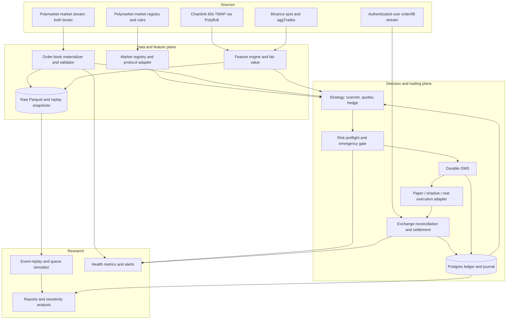
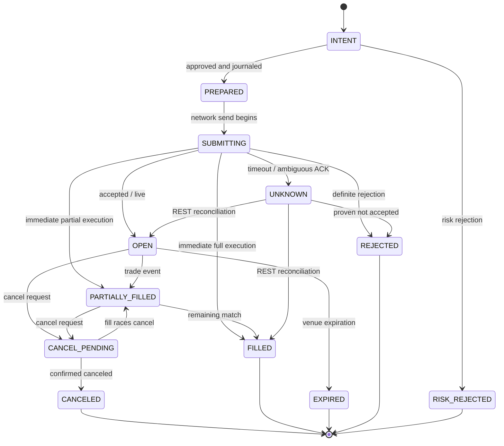

# Bone Reaper-Style Bot | Technical Architecture

**Version:** 1.0  
**Prepared:** 2026-11-06  
**Companion documents:** `PRD.md` contains product requirements; `tasks.md` contains the implementation queue.  
**Status:** Implementation design, not implemented or backtested  
**Target:** Read-only / paper research first; live trading only after explicit future authorization and readiness review.

## 1. Design decisions

| ADR | Decision | Explanation |
|---|---|---|
| ADR-01 | Use the official unified `polymarket-client` Python SDK | As of 2026-11-06, PyPI lists 0.17.0 (2026-11-05). Confirm release/API at implementation time and pin in lockfile. Do not use abandoned legacy `py-clob-client`. |
| ADR-02 | Python >=3.11, `asyncio` event-driven architecture | Low-complexity concurrent market/reference/user streams. Performance optimization comes only after measuring bottlenecks. |
| ADR-03 | Separate data, strategy, risk, and execution via typed interfaces | Identical strategy/risk code serves replay, paper, shadow and live adapters. |
| ADR-04 | A single serialized OMS/ledger writer per wallet | Prevent double orders and contradictory cash/position state; journal decisions before network sends. |
| ADR-05 | Postgres for transactional data; partitioned Parquet for raw market data | Auditable wallet state and inexpensive reproducible historical analysis. SQLite may substitute for Postgres in isolated MVP demos only. |
| ADR-06 | Use exact `Decimal`/integer units for price, amounts and shares | Avoid float errors near low-edge thresholds. |
| ADR-07 | Default to read-only; maker-only as first paper execution strategy | Two-taker opportunities can be fee-negative; passive maker fills have separate queue/unpaired risk. |
| ADR-08 | Market version is explicit in every contract | Protocol V2 uses position IDs; CTF uses token IDs. Never assume legacy IDs. |
| ADR-09 | Fail closed when feed, market, user-order or accounting state is uncertain | Safety supersedes opportunity count. |
| ADR-10 | Resolved outcomes are verified against their *market-specific* rules and Chainlink TWAP | Binance mark, spot or aggTrade prices are not settlement truth. |

### Operational assumptions to confirm during implementation

- The build targets international Polymarket (not the separate Polymarket US SDK).
- Trading settlement and wallet funding use the platform's current pUSD/Polygon mechanisms; fee fields and internal analytics must preserve actual currencies and assets instead of treating pUSD, USDC and token shares as indistinguishable.
- A binary market pays 1 settlement currency unit per winning net share, subject to actual venue resolution, merge and redemption mechanics. Market must be explicitly verified as complementary and supported.
- Fee schedules, order constraints, API shapes, and geographic eligibility can change. Treat docs as an integration checkpoint, not a frozen forever-contract.
- Crypto Up/Down reference is a 60-second Chainlink TWAP stream at the time of writing. Always validate the exact market's reference and rules.

## 2. Context and component map



**Critical boundary:** Only the OMS may call the execution adapter. Signals cannot call trading APIs. The live order-submission adapter is not instantiated in `read_only`, `paper`, or `shadow` modes. An authenticated reference-data-only facade may be used for the TWAP stream if credentials are available, but it exposes no trading methods to the strategy or OMS. The risk manager must approve each order or cancellation/replacement decision before it leaves the OMS. Emergency cancellation is authorized separately from new risk.

## 3. Repository layout

```text
bone-reaper/
├── PRD.md
├── Architecture.md
├── tasks.md
├── README.md
├── pyproject.toml
├── uv.lock
├── .env.example
├── .gitignore
├── config/
│   ├── read_only.yaml
│   ├── paper.yaml
│   └── live.example.yaml
├── src/bone_reaper/
│   ├── __init__.py
│   ├── cli.py
│   ├── app.py
│   ├── settings.py
│   ├── types.py
│   ├── time.py
│   ├── logging.py
│   ├── connectors/
│   │   ├── polymarket_public.py
│   │   ├── polymarket_secure.py
│   │   ├── polymarket_market_stream.py
│   │   ├── polymarket_user_stream.py
│   │   ├── polymarket_twap.py
│   │   ├── binance.py
│   │   └── geoblock.py
│   ├── market/
│   │   ├── discovery.py
│   │   ├── rules.py
│   │   ├── book.py
│   │   ├── validation.py
│   │   └── rollover.py
│   ├── strategy/
│   │   ├── pair_scanner.py
│   │   ├── quotes.py
│   │   ├── hedging.py
│   │   ├── fair_value.py
│   │   └── orchestrator.py
│   ├── risk/
│   │   ├── pretrade.py
│   │   ├── exposure.py
│   │   ├── limits.py
│   │   └── kill_switch.py
│   ├── execution/
│   │   ├── ports.py
│   │   ├── oms.py
│   │   ├── paper.py
│   │   ├── shadow.py
│   │   ├── real.py
│   │   ├── reconciler.py
│   │   └── settlement.py
│   ├── accounting/
│   │   ├── ledger.py
│   │   ├── position.py
│   │   └── pnl.py
│   ├── storage/
│   │   ├── raw_events.py
│   │   ├── checkpoints.py
│   │   ├── postgres.py
│   │   └── schema.sql
│   ├── research/
│   │   ├── replay.py
│   │   ├── taker_fill.py
│   │   ├── maker_queue.py
│   │   ├── latency.py
│   │   ├── metrics.py
│   │   ├── probability.py
│   │   └── reports.py
│   └── telemetry/
│       ├── health.py
│       └── alerts.py
├── tests/
│   ├── fixtures/
│   ├── unit/
│   ├── integration/
│   ├── property/
│   └── fault/
├── scripts/
│   └── smoke_read_only.py
├── sql/
└── reports/
```

## 4. Interfaces and data contracts

Use immutable typed models (dataclasses or Pydantic) and explicit schemas. Schema changes require a version and migration. Every market-data event is enveloped as:

```python
@dataclass(frozen=True)
class EventEnvelope:
    event_id: str                    # deterministic/dedup-able within source
    schema_version: int
    source: str                      # poly_market, poly_twap, binance, poly_user
    topic: str
    market_id: str | None
    asset_id: str | None
    source_ts_ms: int | None         # timestamps from venue/source if present
    received_at_ns: int             # local monotonic arrival for latency ordering
    received_utc_ms: int            # UTC wall-clock receive timestamp
    payload_json: bytes             # exact raw payload for audit/replay
```

**Do not** use local wall-clock arrival time as a surrogate for an absent exchange timestamp without marking it estimated. If no trustworthy event sequence exists, mark a reconnect segment as discontinuous and resnapshot before pricing orders.

| DTO | Required fields | Invariant |
|---|---|---|
| `MarketSpec` | market_id, condition_id, slug, symbol, start/end UTC, outcome types, yes/no asset IDs, market version, tick, min shares, fee parameters, rules hash, oracle source, status | Exactly two verified complementary outcomes; `start < end` |
| `BookState` | market_id, asset_id, sorted bids/asks, last full snapshot, last update, validity, book hash if supplied | No negative quantities; bid < ask in normal active book |
| `ReferenceState` | symbol, Chainlink TWAP, window seconds, source/receive timestamps, start-of-window strike, Binance refs | TWAP input source and timestamps clear |
| `ArbCandidate` | candidate ID, q_net, depth cost, fee breakdown, per-leg available shares, edge before/after costs, time to expiry | Computed from actual depth, not midpoint |
| `QuoteIntent` | market, outcome, BUY/SELL, price, size, post_only, intent ID, expiry cutoff, strategy ID, risk ID | Exact tick/min size; funds reserved |
| `OrderRecord` | intent ID, exchange order ID, state, pending cancel flag, matched quantity, timestamps | Unknown ACK means no blind retry |
| `FillRecord` | exchange trade ID + leg identity, side, liquidity role, price, gross shares, net shares, fee quantity/asset, cash delta, status | Deduplicated by stable fill identity |
| `InventorySnapshot` | available/reserved cash, yes/no gross and net shares, paired/unpaired positions, mark-to-market, locked sets | `paired = min(net_yes, net_no)` |
| `LedgerEntry` | entry_id, cause_id, account, asset, debit, credit, timestamp, settlement status | Double-entry conservation per supported asset |
| `RiskDecision` | request ID, allowed, precise reject reasons, limit snapshot, timestamp | Immutable, auditable authorization |
| `ReplayManifest` | input paths/checksums, coverage, code commit, config and model hash, time period, fee version | Reproducible backtest |

### Canonical amounts

- Store token prices and shares as exact decimal strings or `Decimal`; normalize to exchange-supported precision **at the adapter boundary**.
- Asset IDs must be strings, even when they look like 256-bit integers.
- Use typed `CurrencyAmount(asset, amount)` to avoid mixing pUSD, USDC, fee-in-shares, and payout amounts.
- `fee_amount` is not always cash. A taker BUY can be charged through fewer shares received; a SELL may pay cash fees.
- Market pair inventory is computed in net acquired shares. All expected locked payouts are denominated for **matched net shares** only.

## 5. Public market discovery and market versioning

1. Use official `AsyncPublicClient` and its market pagination APIs to discover current BTC Up/Down 5m markets; use exact market metadata, not regex-only title parsing or assumed slug epochs.
2. Filter for *active, accepting orders, two complementary outcomes*, correct symbol and duration, supported venue version and verified rule source.
3. For CTF, resolve the asset identifier from `market.outcomes.yes.token_id` / `.no.token_id`. For Protocol V2 use `.position_id`; use the current SDK's typed market fields and handle absence as a hard error.
4. Persist rule text/hash, outcome names, start and expiration, Chainlink oracle identity and price-to-beat acquisition method. A market labelled Up/Down is not sufficient evidence that its terms match a previous market.
5. Fetch per-market tick/lot/fee/trading-status constraints at subscription/startup and when the market or tick changes.
6. Prepare the next market near rollover. Stop new orders on the old market at the quote cutoff; cancel and reconcile outstanding orders; preserve unresolved inventory and settlement tracking until final.

Expected input adapters:

```python
from polymarket import AsyncPublicClient

async with AsyncPublicClient() as client:
    pages = client.list_markets(closed=False)
    first_page = await pages.first_page()
    # Filter and validate the typed market objects; do not hard-code outcome IDs.
```

This sketch is intentionally read-only. Verify attribute/method signatures against the SDK installed in the project before implementing every additional call.

## 6. Streaming and order-book materialization

### Polymarket market stream

Use the official typed market subscription where available (market topic with both outcome asset IDs). Handle at least `book`, `price_change`, `last_trade_price`, and `tick_size_change`. Where the SDK exposes additional market-lifecycle events, integrate them after checking supported subscriptions. Each event is durably captured unmodified before normalization.

For each asset:

1. Obtain a full book snapshot, validate and mark the book `READY`.
2. Apply price-level updates with exact size replacement/deletion semantics, as confirmed against the official SDK event schema.
3. Validate prices, sizes, best bid/ask, tick size and optional hashes.
4. On missed events, impossible state, disconnect, incompatible tick or stale data: set `INVALID`, disable strategy for the affected market, resnapshot and reconcile feed state.
5. Write periodic snapshots to accelerate replay, but always preserve source raw events.

**Caveat:** A top-of-book event alone does not reconstruct full-depth liquidity. If only BBO is available during a gap, cannot price quantity beyond that observed depth.

### Chainlink TWAP reference stream

Official current reference topic is `prices.crypto.twap`, supplied through authenticated PolyBolt streaming. Example SDK pattern:

```python
from polymarket.streams import CryptoTwapPriceSpec

async with await client.subscribe(CryptoTwapPriceSpec(symbols=["btcusd"])) as stream:
    async for event in stream:
        # Persist exact source timestamp, source price and 60s window metadata.
        ...
```

`client` above is an authenticated `AsyncSecureClient`; this reference connection is **not** a permission to place orders. Obtain auth for this stream only in eligible and appropriately authorized circumstances, and keep an alternative recorder or explicit unavailable-data state if the feed cannot be accessed. `window_seconds = 60` represents the averaging lookback, **not** one update per minute. Capture the official start-of-round price to beat, final comparison and observed settlement; do not calculate the settlement label from Binance candles.

### Binance adapter

Accept Binance aggTrades, candles and/or price data. Preserve the instrument, source, exchange timestamp, receive timestamp, aggressor direction and contract type. Map BTCUSDT (or futures) to a separate reference instrument; never silently treat USDT or futures marks as the official BTC/USD Chainlink level.

### Flow control

- Separate bounded queues per stream and a market-local decision queue; backpressure must not silently drop order/fill events.
- On market-data overflow, flag a gap, stop strategy, flush audit journal, then resnapshot.
- On authenticated user-stream overflow, stop all new orders and reconcile open orders, trades and balances.
- Record receive latency distributions p50/p95/p99 and wall-clock skew separately.

## 7. Strategy algorithms

### 7.1 Fee calculator and price-depth integration

For a requested **net** pair quantity `q`, compute a cash- and share-aware execution plan for buying Up and Down. Each leg's book asks must have enough liquidity after rounding and fees to reach `q` net shares. Integrate depth from the cheapest ask upward, respecting price tick, share decimals, minimum order and current fee parameters.

Official reference fee expression for taker fills:

`fee_usd_equivalent = gross_shares * market_fee_rate * price * (1 - price)`

The current crypto fee rate may be 0.07, but fetch per market and respect `fees_enabled`, rounding and the SDK/exchange response. Maker fees are currently zero; rebates are variable and **never** treated as guaranteed in pre-trade locked PnL.

Pseudocode:

```text
function evaluate_pair(book_yes, book_no, q_net, market_rules):
    assert both_books_fresh_and_valid()
    leg_yes = buy_plan_for_net_shares(book_yes.asks, q_net, rules)
    leg_no  = buy_plan_for_net_shares(book_no.asks, q_net, rules)
    if not leg_yes.fully_available or not leg_no.fully_available:
        return REJECT_INSUFFICIENT_LIQUIDITY
    capital = leg_yes.cash_spent + leg_no.cash_spent
    payout  = min(leg_yes.net_shares, leg_no.net_shares) * 1
    edge = payout - capital - explicit_non_fee_costs - adverse_execution_reserve
    if edge < configured_absolute_threshold or edge/capital < configured_roi:
         return REJECT_EDGE
    return Candidate(edge, matched_size, every_price_level, fee_details, book_ages)
```

The execution reserve is a risk estimate, not proof that partially filled orders are safe. The paired payoff becomes locked only once all matched net shares are held or equivalent complete-set mechanics are successfully confirmed.

### 7.2 Passive dual-outcome quote generator

Start with one YES bid and one NO bid per market and a single quote level per outcome. Other quotes are optional after measurements. Fair prices can initially be midbook or simple bounded benchmark, but the market's fair probability must not be inferred from one stale book.

```text
proposed_yes_bid = min(best_bid_yes + tick, fair_yes - margin_yes, 1 - expected_no_hedge_cost - pair_buffer)
proposed_no_bid  = min(best_bid_no + tick,  fair_no  - margin_no,  1 - expected_yes_hedge_cost - pair_buffer)
```

Round each bid **down** to an allowed tick. Verify bid remains strictly nonmarketable if `post_only = true`. Skip if below minimum viable market price, if no counterpart liquidity exists, if the combined intended cost is unsafe, or if unpaired inventory breaches limits. Quote size takes into account cash reservations for **both outstanding orders**, potential sell inventory, position imbalance, time left, maximum loss, and fee/hedge buffers.

Change quotes only if a material threshold is crossed (e.g., two ticks and/or configured age). A cancel request is not proof that the old quote has vanished, so reserve worst-case exposure until a confirmed cancellation or reconciliation.

### 7.3 Hedging and inventory

```text
on_fill(fill):
    dedupe_and_commit_fill_once(fill)
    paired = min(YES_net_shares, NO_net_shares)
    unpaired = abs(YES_net_shares - NO_net_shares)
    reserve_for_open_orders_and_unknown_order_state()
    if risk_limit_exceeded: cancel_new_quotes_and_attempt_approved_risk_reduction()
    else if paired_counterleg_can_be_bought_profitably_after_all_costs: consider_hedge()
    else if passive_counterpart_is_safe: rest_counterpart_quote()
    else: do_not_add_risk_and_alert()
```

A deliberately loss-making risk-reducing taker hedge is a different policy from a profitable arbitrage entry; it needs its own capped cost budget. Under no circumstances convert a failed hedge into a fictitious locked arbitrage PnL entry.

### 7.4 Probability model

Start with a transparent baseline using normalized distance from Chainlink start TWAP to latest TWAP, remaining seconds and short-horizon realized volatility. Add Binance trade-sign imbalance, trend and order-book features only after demonstrating predictive improvement. Train per well-defined time horizons, never randomly mixing overlapping 5-minute markets across train/test splits. Avoid using events received after the prediction timestamp.

Evaluate Brier/log loss, reliability buckets, calibration drift, economic incremental net PnL, maker fill quality and sensitivity to delayed reference events. Gate model trading separately from baseline strategy eligibility.

## 8. Risk engine and modes

```yaml
mode: read_only              # read_only | paper | shadow | live
live_enabled: false
live_operator_approval: false
markets:
  symbols: [BTC]
  durations_minutes: [5]
  max_concurrent: 1
strategies:
  scan_pair: true
  passive_quotes: false
  probability_model: false
  min_net_edge_usd: "0.50"
  min_net_roi: "0.01"
  allow_taker_taker: false
  allow_negative_edge_risk_hedge: false
  refresh_min_ticks: 2
risk:
  max_order_notional_usd: "10"
  max_unpaired_notional_usd: "20"
  max_total_gross_notional_usd: "100"
  max_daily_realized_loss_usd: "10"
  max_open_orders: 4
  stop_new_quotes_seconds_before_close: 20
  max_book_age_ms: 1000
  max_reference_age_ms: 2000
  max_user_stream_silence_ms: 5000
  max_unexplained_reconciliation_usd: "0.01"
execution:
  maker_post_only: true
  prefer_order_type: GTC
  cancel_on_disconnect: true
  retry_unknown_order_submit: false
  reconcile_on_reconnect: true
storage:
  raw: parquet
  ledger: postgresql
```

**Modes:**

- `read_only`: market data, scanner and reports; **no order-submission adapter**. Public book scanning requires no wallet credentials. The optional Chainlink reference stream may require an authenticated data-only SDK facade; it is isolated from execution and must be unable to place orders.
- `paper`: same signal/risk stack, fully simulated order/fill/account adapter. Actual market feed may be live but fills are simulated and flagged.
- `shadow`: evaluate intended orders against live books and record hypothetical fills; **no order submission**.
- `live`: one explicitly authorized wallet, real trading adapter, user stream, comprehensive reconciliation and a hard operator approval gate. Never automatically switch modes or re-enable after a fatal risk event.

Before every new real order validate: eligibility (geoblock and account), market state, version, rule hash, fee config, source freshness, oracle features if used, tick and lot rules, collateral reservation, outstanding possible fills, max total exposure, daily realized loss, countdown, open order count, clock skew and kill-switch state. Stop new orders on any uncertainty. Cancellations and legally/technically permissible risk reductions use separate controlled pathways.

**Geographic check:** `GET https://polymarket.com/api/geoblock` must run from the actual trading execution location, not a proxy chosen to bypass restrictions. If blocked, response is invalid/unknown, or legal eligibility is unresolved, no new live trade.

## 9. OMS, execution and reconciliation

### 9.1 State machine



For every order intent, write a durable journal entry and reserve funds before network send. Use a stable internal intent ID, request correlation ID, exchange order ID, and wallet/market key. Never blindly retry a timed-out non-idempotent submit. First reconcile by REST/open orders/recent trades and only conclude rejected when evidence is sufficient. Exchanges may emit fills before an ACK; maintain order-ID and trade-ID matching independently.

### 9.2 Order types and expiry

- For passive quoting use GTC with `post_only=True`; Polymarket's GTC/GTD are resting orders; maker batch requests are **not atomic**.
- GTD expires one minute before the stated expiry and requires a sufficiently long future timestamp. On a 5-minute market with frequent quote changes, prefer explicit cancel/reconcile over GTD for short quote lifetimes.
- FOK may suit an immediate hedge that must fill fully; FAK permits partial fills and therefore may worsen unpaired exposure. Verify real SDK semantics and venue constraints before use.
- Never call an order canceled until acknowledged. A pending cancel still counts against possible gross exposure.

### 9.3 Reconciliation procedure

At process startup, after every authenticated-stream reconnect, after ambiguous submit/cancel results, periodically during operation, and after settlement:

1. Freeze new risk and fetch exchange open orders, recent account trades, balances and on-chain position state.
2. Deduplicate fills using immutable exchange trade identifiers and leg identity, accounting for trade statuses and possible reversals/failures.
3. Merge validated remote events into the journal transactionally; compute cash, reserved orders, gross shares, net shares, fees and redemptions.
4. Compare all account/market ledgers and correct by documented reconciliation entries rather than editing history.
5. Resume only if every unmatched state is understood within a strict budget and risk manager authorizes it.

### 9.4 Settlement

After market trading closes, identify its confirmed resolution via the venue's authoritative resolution fields. Mark winning shares redeemable but not available cash. Merge complete sets only where supported by that market/protocol and wallet route; on failed merges wait and reconcile. Redeem winning tokens through official SDK workflows and confirm changes in balances and chain state. Final realized PnL must not double count merge proceeds and settlement payouts.

## 10. Accounting and relational storage

### 10.1 Minimum durable relational tables

| Table | Primary key | Important columns |
|---|---|---|
| `markets` | `market_id` | condition_id, version, outcome ids, rules hash, oracle source, fee rate, start/end, status |
| `order_intents` | `intent_id` | created_at, market_id, side, asset_id, quantity, price, strategy, risk_approval_id, status |
| `orders` | `exchange_order_id` | intent_id, remote state, requested and matched shares, pending cancel, last update |
| `fills` | `trade_id + order_leg_key` | order_id, asset_id, executed shares, net shares, cash delta, fee amount/asset, role, status |
| `ledger_entries` | `entry_id` | cause_id, wallet_id, asset, debit, credit, timestamp, reversal_of |
| `cash_reservations` | `reservation_id` | intent_id, asset, amount, reserved/released state |
| `inventory_snapshots` | `snapshot_id` | market, paired/unpaired quantities, reserved cash, valuations |
| `risk_decisions` | `risk_decision_id` | request, allowed, reasons, limits snapshot |
| `reconciliation_runs` | `run_id` | remote/local diffs, state, run timestamp, evidence path |
| `settlements` | `settlement_id` | market, winning outcome, status, cash releases, confirmed time |
| `run_manifests` | `run_id` | mode, config hash, git commit, SDK version, dataset hashes, start/end |

**Transaction invariant:** an order intent, reservation update and journal entry are committed atomically. Likewise a fill and all accounting effects must commit exactly once. Use unique indexes on exchange trade/leg identity and on internal intent ID. Only one process may own the account-level OMS lock at a time.

### 10.2 Raw event and replay storage

Partition append-only Parquet by `source/YYYY-MM-DD/symbol/market_id`. Preserve exact raw payload, normalized fields, source timestamp, receive timestamp, schema version and connection segment ID. Create snapshots at fixed intervals and on market rollover; snapshots reference the raw event offset. Do not rewrite historical raw records during data corrections; add correction manifests.

For user-provided Binance files create an ingestion manifest: source path, period, symbol, spot/futures, units, timezone, row counts, duplicate counts, gaps and checksum.

## 11. Simulator and backtesting methodology

**Must-have maker inputs:** Full Polymarket L2 snapshots/deltas with trades and timestamps for both outcomes, trading rules and fee history, reference TWAP, market resolution, and plausible latency and queue models. Price candles and last trades by themselves cannot establish maker fills.

Replay pipeline:

1. Read raw events in source-time order but deliver them to the strategy at **recorded or simulated receive times**. No lookahead.
2. Rebuild exchange books and separate bot-visible books. Bot-visible state may lag the exchange-simulated state.
3. Evaluate strategy/risk using only currently visible state. Apply submission and cancel latency distributions.
4. Taker fills consume actual available depth at simulated order arrival. Model price deterioration and partial fills.
5. Maker quotes join behind existing queue volume at that price plus an uncertainty reserve. Estimate or bracket front-of-queue fills conservatively. A mere price touch does **not** fill the order.
6. Model peer market order flow, cancellations, unresolved queue identity, and conservative fill probability bands. Report under pessimistic, central and optimistic assumptions, not as one true historical fill count.
7. Track all order states, fees, net shares, cash reservations, incomplete hedges, settlements and realized PnL through the **same** ledger and risk contracts used by paper/live.
8. Run sensitivity experiments: doubled latency, adverse fill assumptions, higher fees if allowed, zero rebates, bigger hedge slippage, and data gaps.
9. Use chronological train/validation/untouched test windows with an embargo for overlapping horizons. Report all test windows, trade counts and uncertainty intervals.

### Metrics and scenarios

- Absolute and per-market net PnL, cash equity, realized/unrealized attribution and max drawdown.
- Capital deployed, ROI on capital, inventory holding duration, fraction paired, fraction unpaired at close, opportunity count and opportunity lifetime.
- Passive quote fill ratio, price improvement, adverse-selection markouts at 1s/5s/30s, quoted vs executable edge, taker fee drag.
- p50/p95/p99 data-to-decision, decision-to-submit, submit-to-ACK, cancel and fill delays.
- Strategy performance by near-expiry bucket, volatility and outcome probability; model Brier score and calibration.
- Failure counts: reconnection, rejected orders, unknown ACK, cancel races, bad snapshots and missing resolution.

## 12. Observability and operations

Export structured JSON logs with `run_id`, `market_id`, `intent_id`, `order_id`, `reason_code`, source timestamps and trace IDs. Never log signing keys, raw authorization headers or seed phrases.

Prometheus-style metrics if deployed: `market_book_age_ms`, `reference_age_ms`, `ws_disconnects_total`, `event_queue_depth`, `decision_latency_ms`, `orders_open`, `orders_unknown`, `unpaired_notional_usd`, `realized_pnl_usd`, `risk_rejections_total`, `reconciliation_diff_usd`, `kill_switch_active`.

Startup procedure: validate config, record software versions, check eligibility if relevant, bind the single-wallet OMS lock, restore journal, reconcile (if secure), subscribe, validate market/rules/book/reference state, then activate *only* the configured non-forbidden strategies. On process restart, never automatically assume previously pending orders were rejected.

Shutdown procedure: stop new risk, attempt cancel if permitted, record every cancellation response, reconcile, flush audit and Parquet, and leave unresolved positions and orders in the manifest. Termination must not report clean shutdown if unknown state persists.

Alert for market rollover failure, stale feed, oracle mismatch, account stream silence, unknown orders, oversized unpaired risk, daily loss stop, ledger discrepancy, disk write error, or geoblock change. A kill switch prevents new risk and attempts cancellation where allowed; it does not guarantee forced liquidation.

## 13. CLI contract

The entry point should be `bone-reaper` (and `python -m bone_reaper` if packaged), with flags that do not silently change trading modes.

```bash
bone-reaper doctor --config config/read_only.yaml
bone-reaper markets --symbol BTC --duration 5
bone-reaper record --config config/read_only.yaml --markets btc-updown
bone-reaper scan --input data/raw --config config/read_only.yaml --report reports/scan.json
bone-reaper replay --input data/raw --config config/paper.yaml --output reports/replay
bone-reaper paper --config config/paper.yaml
bone-reaper health --config config/read_only.yaml
bone-reaper reconcile --dry-run   # only with authorized account access
```

All commands must print the resolved mode, config hash and allowed/disallowed network actions. There is no `live` default, and any future live CLI requires a separate approval mechanism and explicit human action.

## 14. Validation and failure-injection tests

| Test group | Required cases |
|---|---|
| Market registry | Correct BTC 5m rollover; CTF vs V2; inverted YES/NO; missing rule; unsupported negative-risk market; changed fee; changed tick |
| L2 book | Empty levels; crossed book; stale or out-of-order updates; snapshot/hash divergence; disconnect/reconnect; oversized queue |
| Fee and arithmetic | 0.46/0.51 fee-negative example; fee in shares; fee rounding; multi-level VWAP; net-share matching; tick and lot rounding |
| Strategy | Paired positive edge, insufficient depth, nonmarketable post-only, one-side bid fill, costly hedge, expiry cutoff |
| OMS | ACK lost but order live; duplicate user trade; fill before ACK; cancellation race; batch one side rejects; process restart |
| Ledger | No negative available cash, unique fill application, exact cash/share conservation, merge and redemption cannot double count |
| Risk | Geoblocked/unknown permission, bad wallet state, late market, stale oracle, daily stop, disconnect, operator approval absent |
| Replay | Deterministic seed, causality checks, queue-ahead no-fill case, slippage, delayed cancel, held-out dataset provenance |
| Operations | Disk full, database unavailable, process signal, clock skew, server rate limit, matching-engine restart |

Unit/property tests are always offline. Authenticated integration tests must be explicitly opted in. Tests that may transmit orders must be segregated and disabled in CI with unmistakable warnings and budget limitations.

## 15. Performance and release gates

- Before performance tuning, build correct fee, queue and PnL modeling. Do not optimize the number of orders per minute as a goal.
- A strategy with positive gross edge but negative conservative after-fee net PnL is rejected.
- A strategy with one-sided catastrophic risk is rejected even if average replay PnL is positive.
- Before any live release: passing simulated fault suite, chronological holdout evidence, 0 unexplained ledger mismatches, reconciler readiness, measured quote/ACK/cancel latencies, eligibility approval, dedicated small-risk wallet and tested kill switch.
- Any protocol/fee/market-rules update requires fresh validation; never assume previous success proves the new deployment profitable.

## 16. API sources and integration checks

Use the following official reference links in implementer comments/ADRs:

1. Python SDK, clients and releases: https://docs.polymarket.com/getting-started/python and https://pypi.org/project/polymarket-client/
2. Official SDK source: https://github.com/Polymarket/py-sdk
3. Market stream event models: https://docs.polymarket.com/market-data/realtime-data
4. Authenticated order/fill events: https://docs.polymarket.com/trading/realtime-order-updates
5. Orders, post-only, GTC/GTD/FOK/FAK: https://docs.polymarket.com/trading/place-orders
6. Market-making account and quoting guidance: https://docs.polymarket.com/trading/market-making
7. Fee formula and market rate: https://docs.polymarket.com/trading/fees
8. Chainlink TWAP resolution: https://docs.polymarket.com/concepts/resolution
9. Geographic eligibility endpoint: https://docs.polymarket.com/api-reference/geoblock

**Implementation priority:** Build code against actual SDK models that are installed and pinned, then verify that official examples still match them. Record any verified incompatibility as an ADR and test it. Consult `tasks.md` for dependency order and completion checklist.
